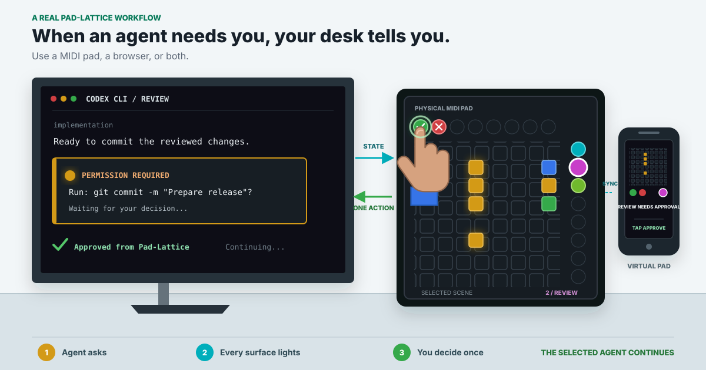

  
  
<em>Human-in-the-loop control surfaces for AI agents</em>

# Pad-Lattice

**🖥️ Desktop app:** <https://mrueda.github.io/pad-lattice/docs/usage/install>

**🎛️ Try the virtual pad:** <https://mrueda.github.io/pad-lattice/play/>

**📘 Documentation:** <https://mrueda.github.io/pad-lattice/>

**See which Codex CLI session needs you, then act on it.** Pad-Lattice uses
colors and glyphs to show agent activity. Select a session to approve or reject
a pending request, or stop a running turn. Prompts and replies stay in Codex.

Use the desktop app, a phone or tablet browser, or a physical MIDI controller.
All share the same visual language. **No MIDI hardware is required.**

  

## Get Started

**Desktop is recommended.** Follow the
[installation guide](https://mrueda.github.io/pad-lattice/docs/usage/install)
and [Quick Start](https://mrueda.github.io/pad-lattice/docs/usage/quickstart).
Python is bundled; Codex CLI must be installed and authenticated separately.

Prefer a terminal? Install with `pipx install pad-lattice` and follow
[CLI Setup](https://mrueda.github.io/pad-lattice/docs/usage/cli).

The public playground is a simulation. Hardware support and testing status are
listed in the [Device Catalog](https://mrueda.github.io/pad-lattice/docs/usage/device-catalog).

[Changelog](CHANGELOG.md) · [Citation](CITATION.cff) · [Technical guide](https://mrueda.github.io/pad-lattice/docs/technical-details/)

## License

Copyright (C) 2026 Manuel Rueda.
Distributed under the [Apache License 2.0](LICENSE).
